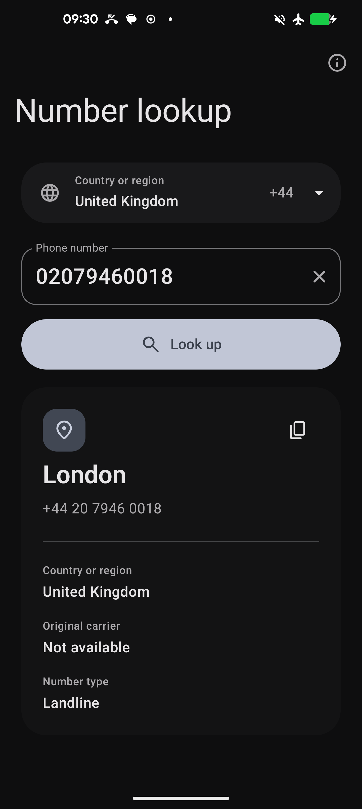
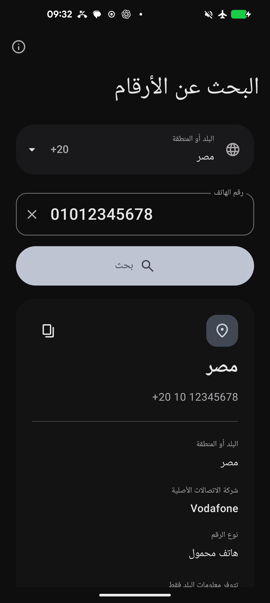

# Number Lookup

[简体中文](README.md) · [Download](https://github.com/RiversLee9312/PhoneNumberQuery/releases/latest) · [Open-source licenses](THIRD_PARTY_NOTICES.md)

An offline Android phone-number region lookup app. Choose a country or region,
enter a national-format number, and view its allocation region, original carrier,
and number type.

<p>
  
  
</p>

## Features

- Bundled numbering plans for 245 regions, offline geocoding and carrier metadata,
  plus 520,170 China mobile-prefix records.
- 24 languages across 25 locale variants, RTL layout, Unicode digits, and Android
  per-app language settings.
- Default dialing region follows the language locale. Regions can be selected or
  searched by name, ISO code, or calling code.
- Kotlin and Jetpack Compose with official Material 3 Expressive components,
  shapes, and motion.
- System light/dark modes, Android 12+ dynamic color, and an explicit Android 13+
  themed launcher icon layer.
- No internet, contacts, phone, or location permissions. Queries stay on the
  device, and no lookup history is stored.
- In-app project and third-party license pages.

Results describe original number allocation, not the subscriber's current
location. Some numbers have country-level detail only. Number portability may
change the current carrier.

## Install

Download `NumberLookup-1.0.0-release.apk` from
[Releases](https://github.com/RiversLee9312/PhoneNumberQuery/releases/latest).
Android 8.0 / API 26 or newer is required. A SHA-256 checksum is provided alongside
the APK.

Production releases use a dedicated signing certificate. Uninstall an earlier
debug build before installing the first production release; subsequent production
releases can update it normally. Themed icon appearance depends on the launcher.

## Build

Use JDK 21 and Android SDK 36. Open the root in Android Studio, set `ANDROID_HOME`,
or configure `sdk.dir` in a local, untracked `local.properties` file. Dependency
downloads require a connection on the first build; runtime lookups do not.

```bash
./gradlew :app:assembleDebug
```

Use `gradlew.bat` on Windows. The debug APK is written to
`app/build/outputs/apk/debug/`.

### Signed release

Copy `keystore.properties.example` to `keystore.properties` and configure your own
keystore path, alias, and passwords:

```bash
./gradlew :app:assembleRelease
```

A configured signing key produces `app/build/outputs/apk/release/app-release.apk`;
without it the build produces an unsigned APK. R8 and resource shrinking are enabled.

Signing properties and keystores are ignored by Git. Keep a private backup outside
the repository: future updates require the same signing key.

### Checks

```bash
python tools/validate_i18n.py
./gradlew :app:testDebugUnitTest :app:lintDebug :app:lintRelease
./gradlew :app:connectedDebugAndroidTest
```

Device tests require an authorized ADB device. They cover number examples, national
formats, Unicode digits, region selection, localized resources, permissions, and
license-page navigation.

Compile and target SDK: 36. Material 3 Expressive uses `material3:1.5.0-alpha14`;
other Compose components use BOM `2026.02.01`.

## License

Original code, documentation, and launcher artwork use [Apache-2.0](LICENSE).
Third-party components retain their original licenses. The China prefix database
remains under MIT.

- [NOTICE](NOTICE)
- [Third-party notices](THIRD_PARTY_NOTICES.md)
- In the app: About → Open-source licenses

## Documentation

- [Offline data provenance](docs/DATA_SOURCES.md)
- [China prefix cross-check](docs/DATA_AUDIT.md)
- [Internationalization](docs/I18N.md)
- [Icon artwork](docs/ICON.md)
- [Initial validation](docs/VERIFICATION.md)
- [Release signing and validation](docs/RELEASE.md)
