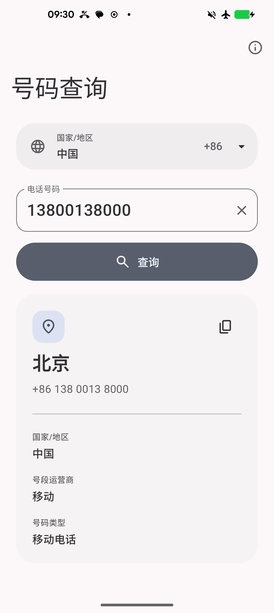
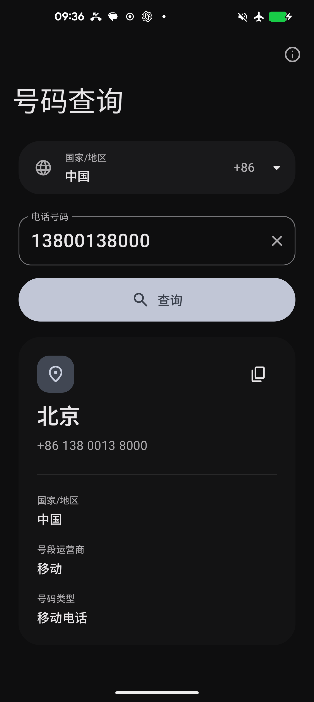

# 号码查询 · Number Lookup

[English](README.en.md) · [下载最新版本](https://github.com/RiversLee9312/PhoneNumberQuery/releases/latest) · [开源许可证](THIRD_PARTY_NOTICES.md)

Kotlin + Jetpack Compose 原生 Android 工具。选择国家或地区，输入当地格式的电话号码，查询号段归属地、原始运营商与号码类型。

<p>
  
  
</p>

- 所有数据随 APK 打包；不申请网络、联系人、电话或定位权限。
- Google libphonenumber 提供 245 个地区的号码规则与离线地理、运营商数据；中国大陆补充 520,170 条手机号段记录。
- 使用 Material 3 Expressive 官方组件、形状与动效，Android 12 起采用系统动态配色，支持系统深浅色。
- 提供 24 种语言、25 个语言/地区版本，支持 RTL 和 Android 13 起的系统应用语言设置。
- 启动器图标由 GPT Image 生成，包含 Adaptive Icon 前景、背景与显式 monochrome 图层。
- 默认地区由当前语言设置决定，可手动选择或搜索其他地区和区号。
- 不保存查询历史，应用内提供项目与第三方开源许可证详情页。

归属地是号段分配信息，无法表示号码持有者的当前位置。不同地区的数据精度不同，部分号码仅能显示国家或地区；携号转网后的运营商可能不同。

## 安装

从 [Releases](https://github.com/RiversLee9312/PhoneNumberQuery/releases/latest) 下载 `NumberLookup-1.0.0-release.apk`，需要 Android 8.0（API 26）及以上。发布页提供 SHA-256 校验文件。

正式版使用独立发布证书。此前安装过调试版时，需先卸载调试版再安装正式版；后续正式版可正常覆盖更新。Themed Icon 的显示取决于启动器支持。

## 构建

编译及目标 API 为 36。需要 JDK 21 和 Android SDK 36，Gradle Wrapper 已包含在项目中。首次解析依赖需要联网，应用运行时完全离线。

```powershell
.\gradlew.bat :app:assembleDebug
```

用 Android Studio 打开根目录，或设置 `ANDROID_HOME`，也可以在未纳入版本控制的 `local.properties` 中设置 `sdk.dir`。macOS / Linux 使用 `./gradlew`。

### Release 签名

复制 `keystore.properties.example` 为 `keystore.properties`，填入自己的密钥库路径、别名和密码，然后构建：

```powershell
.\gradlew.bat :app:assembleRelease
```

配置签名后输出 `app/build/outputs/apk/release/app-release.apk`，未配置时输出 unsigned APK。Release 启用 R8 和资源压缩。

实际签名配置和密钥库均被 Git 忽略。请在仓库外备份发布密钥和密码配置，后续更新必须使用相同签名。

### 验证

```powershell
python tools\validate_i18n.py
.\gradlew.bat :app:testDebugUnitTest :app:lintDebug :app:lintRelease
.\gradlew.bat :app:connectedDebugAndroidTest
```

测试包含全球号码样例、Unicode 数字、国内格式解析、中国号段数据、多语言资源、地区选择、主题图标和许可证页面。真机测试需要已授权 ADB 的 Android 设备。

Material 3 Expressive API 使用 `androidx.compose.material3:material3:1.5.0-alpha14`，在源码中明确选择加入对应实验 API。其余 Compose 组件由 `2026.02.01` BOM 管理。

## 开源许可

项目原创代码、文档和应用图标使用 [Apache License 2.0](LICENSE)。第三方代码、图标和数据保留各自许可，其中中国号段数据库仍使用 MIT License。

- [NOTICE](NOTICE)
- [第三方组件、版权与许可证](THIRD_PARTY_NOTICES.md)
- 应用内：关于 → 开源许可证

## 资料

- [离线数据来源、版本与校验值](docs/DATA_SOURCES.md)
- [国内号段交叉核对](docs/DATA_AUDIT.md)
- [国际化资源与语言清单](docs/I18N.md)
- [图标生成与适配记录](docs/ICON.md)
- [验证记录](docs/VERIFICATION.md)
- [正式版发布与签名验证](docs/RELEASE.md)

界面符号使用 [Google Fonts Material Symbols Rounded](https://fonts.google.com/icons)，以 Vector Drawable 内置，无需下载字体。参考 [Material 3 Expressive](https://m3.material.io/blog/building-with-m3-expressive) 和 [Android Adaptive Icons](https://developer.android.com/develop/ui/compose/system/icon_design_adaptive) 官方文档。
